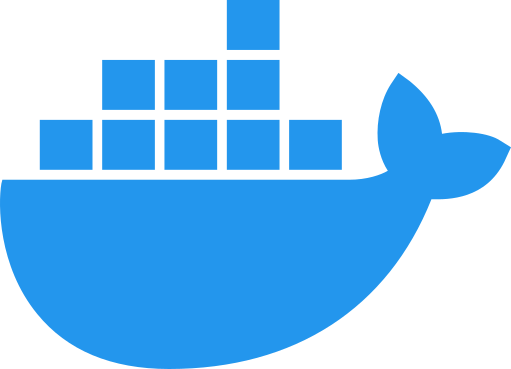

<p align="center">
  
</p>

<h1 align="center">aac-dockermon</h1>

<p align="center">Self-hosted deployment definition for Dockermon, a small REST API that reports and controls Docker container status for Home Assistant.</p>

<p align="center">
  <a href="https://github.com/philhawthorne/ha-dockermon"></a>
  
  <a href="https://github.com/philhawthorne/ha-dockermon/blob/master/LICENSE"></a>
</p>

## About

Dockermon is a NodeJS RESTful API that checks the status of Docker containers and returns the
result as a JSON response. It is designed to be called from Home Assistant, which can use the
answers to show container state or trigger container actions. The upstream project was
primarily built for running Home Assistant alongside containers on a Synology NAS.

Key features (as provided by upstream):

- Get the status of a container (running, stopped, paused)
- Start, stop, pause, unpause and restart containers via HTTP
- List all containers and read container statistics (CPU, memory)
- Run commands inside a container through an `/exec` endpoint
- Optional HTTP basic authentication and configurable Docker connection (socket or TCP)

## Upstream

- Project: <https://github.com/philhawthorne/ha-dockermon>
- Container image: `philhawthorne/ha-dockermon:v0.0.13` (Docker Hub)
- License: MIT (upstream project)

## Quick start (Docker Compose)

The Compose file is rendered from `service.yml` by the App-as-Code template engine. For a
manual run, the external networks used for routing must exist first:

```bash
docker network create services-secured
docker network create services-exposed

docker compose up -d
```

This deployment defines no secrets. If you add any, provide them through the deployment
pipeline or in a `stack.env` file next to the Compose file, and do not commit them.

## Configuration

Environment variables (defaults from `service.yml`):

| Variable | Default | Description |
|---|---|---|
| `PUID` | `1000` | User ID the container runs as |
| `PGID` | `1000` | Group ID the container runs as |
| `TZ` | `Europe/Berlin` | Time zone |

Ports:

| Port | Protocol | Purpose |
|---|---|---|
| `8126` | TCP | HTTP API (`web`) |

Volumes:

| Mount | Description |
|---|---|
| `/var/run/docker.sock` (read-only) -> `/var/run/docker.sock` | Docker socket that the API queries |
| `config` -> `/config` | Dockermon configuration directory (`configuration.yaml`) |

Read-only access to the Docker socket gives the container visibility into the host's Docker
daemon. Restrict who can reach the API, because container start/stop actions are exposed
over HTTP.

## Deploy with App-as-Code

1. Edit `service.yml`. It is the single source of truth for image, ports, environment,
   volumes and per-stage overrides. Do not edit the rendered output.
2. Pushing to `main` (or a configured stage branch) runs the service pipeline, which renders
   the manifests with `aac-template-engine` and triggers the deployment.
3. Releases of this definition are published under <https://github.com/app-as-code/aac-dockermon>.

## Credits and license

Dockermon is developed by its upstream project and licensed under MIT. This repository only contains
the deployment definition for it and is not a fork of the application. The Docker logo is a
trademark of Docker, Inc.; see [`assets/ICON_SOURCE.md`](assets/ICON_SOURCE.md) for the icon
source and license.
